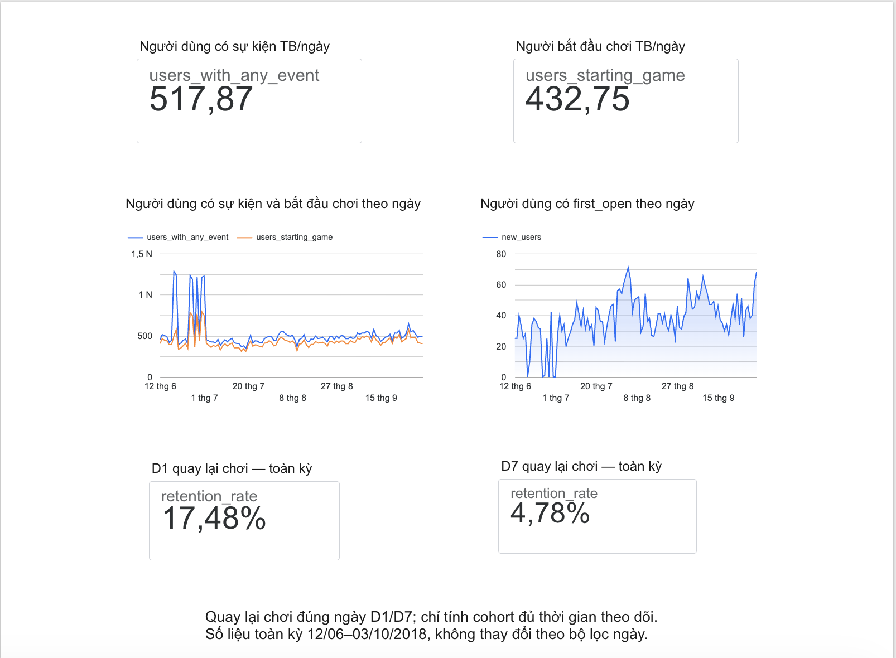
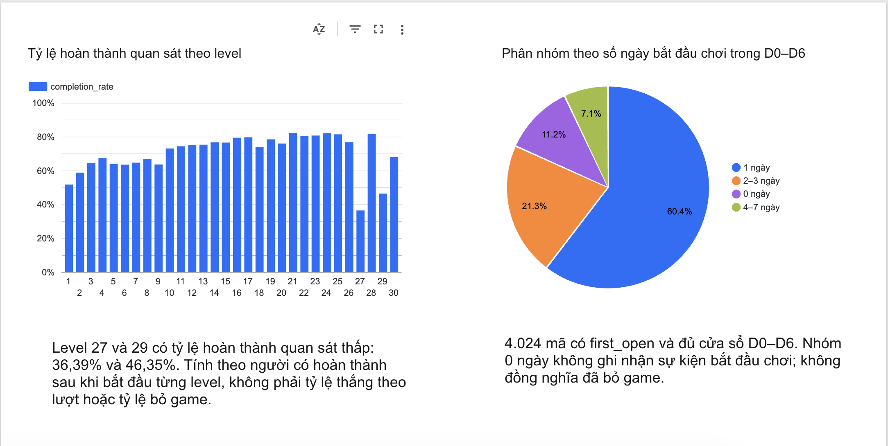
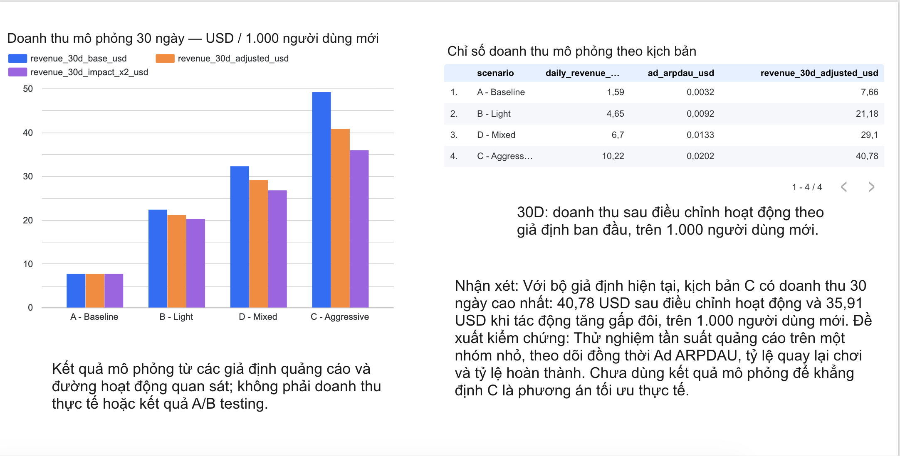

# Flood-It: Player Behavior & Ads Monetization Simulation

Phân tích hành vi người chơi từ dữ liệu Firebase công khai và xây dựng mô hình mô phỏng doanh thu quảng cáo.

> Phân tích hành vi sử dụng dữ liệu quan sát trong dataset. Doanh thu và tác động của quảng cáo đến hoạt động người chơi là giả định mô phỏng, không phải doanh thu thực tế hay kết quả A/B testing.

## 1. Mục tiêu

- Phân tích người dùng theo ngày và retention quay lại chơi.
- Xác định các level cần kiểm tra thêm về trải nghiệm chơi.
- Phân nhóm người dùng theo số ngày bắt đầu chơi.
- So sánh doanh thu quảng cáo giữa các kịch bản và kiểm tra độ nhạy.

## 2. Dữ liệu và công cụ

Nguồn dữ liệu BigQuery:

`firebase-public-project.analytics_153293282.events_*`

| Nội dung | Giá trị |
|---|---:|
| Khoảng thời gian | 12/06/2018–03/10/2018 |
| Số ngày có dữ liệu | 114 |
| Tổng sự kiện | 5.700.000 |
| Số user_pseudo_id khác nhau | 15.175 |

Mỗi ngày có chính xác 50.000 sự kiện. Đây là dấu hiệu dữ liệu có thể đã được lấy mẫu hoặc giới hạn số dòng; dự án chưa xác minh được cơ chế.

Công cụ: BigQuery SQL, Google Sheets, Looker Studio, VS Code.

## 3. Phương pháp

### Chỉ số người dùng

- Người dùng có sự kiện/ngày: số user_pseudo_id khác nhau có bất kỳ sự kiện nào.
- Người bắt đầu chơi/ngày: số mã có `level_start` hoặc `level_start_quickplay`.
- Người có first_open/ngày: số mã ghi nhận `first_open` trong ngày.
- Các chỉ số ngày sử dụng nhất quán `event_date`.

### Retention quay lại chơi

- Cohort được xác định bằng ngày first_open đầu tiên quan sát được của mỗi mã.
- Quay lại chơi yêu cầu có `level_start` hoặc `level_start_quickplay`.
- D1 và D7 xét đúng ngày thứ 1 và thứ 7.
- Chỉ tính cohort đủ thời gian theo dõi.
- Tỷ lệ tổng hợp bằng tổng số người quay lại chia tổng số người đủ điều kiện.

### Hoàn thành theo level

Chuẩn hóa tham số `level` từ cả `int_value` và `double_value`.

Tại mỗi level, đếm người có sự kiện hoàn thành sau lần bắt đầu đầu tiên được quan sát, chia cho số người có sự kiện bắt đầu level đó.

Đây là tỷ lệ theo người tại từng level, không phải tỷ lệ thắng theo lượt hoặc funnel tuần tự.

### Phiên ước lượng

- Tạo phiên mới khi hai timestamp liên tiếp của cùng một mã cách nhau hơn 30 phút.
- Loại `app_remove`, `app_update`, `os_update` và timestamp NULL.
- Độ dài phiên là khoảng cách giữa sự kiện đầu và cuối, không phải thời gian tương tác liên tục.

### Phân nhóm

Chọn các mã có first_open đầu tiên không muộn hơn 27/09/2018, đếm số ngày có sự kiện bắt đầu chơi trong D0–D6.

Giữ cả nhóm không ghi nhận bắt đầu chơi.

## 4. Kết quả chính

### Tổng quan và retention

| Chỉ số | Kết quả |
|---|---:|
| Người dùng có sự kiện trung bình/ngày | 517,87 |
| Người bắt đầu chơi trung bình/ngày | 432,75 |
| D1 quay lại chơi | 743 / 4.251 = 17,48% |
| D7 quay lại chơi | 191 / 3.998 = 4,78% |

Ngày 18/06 có 1.283 mã có sự kiện, nhưng chỉ 495 mã có sự kiện bắt đầu chơi. Có 537 mã chỉ ghi nhận screen_view trong ngày này.

Vì vậy, tăng số người có sự kiện chưa đồng nghĩa số người bắt đầu chơi tăng tương ứng.

### Level cần kiểm tra

| Level | Người bắt đầu | Hoàn thành sau khi bắt đầu | Tỷ lệ |
|---|---:|---:|---:|
| 27 | 731 | 266 | 36,39% |
| 29 | 397 | 184 | 46,35% |

Level 27 ghi nhận 3.795 sự kiện thất bại và 3.966 sự kiện thử lại. Level 29 tương ứng có 1.759 và 1.812 sự kiện.

Kết quả gợi ý đây là các điểm cần kiểm tra thêm, chưa chứng minh độ khó gây ra việc rời game.

### Phân nhóm trong D0–D6

| Số ngày bắt đầu chơi | Số mã | Tỷ trọng |
|---|---:|---:|
| 0 ngày | 452 | 11,23% |
| 1 ngày | 2.430 | 60,39% |
| 2–3 ngày | 858 | 21,32% |
| 4–7 ngày | 284 | 7,06% |

Trong 4.024 mã này, có 112 mã ghi nhận ad_reward, với tổng 378 sự kiện thưởng.

Tỷ lệ có ad_reward lần lượt là 1,36%, 6,06% và 9,51% ở các nhóm chơi 1 ngày, 2–3 ngày và 4–7 ngày. Đây là mối liên hệ quan sát được, không chứng minh quảng cáo thưởng làm tăng mức độ gắn bó.

### Phiên ước lượng

| Chỉ số | Kết quả |
|---|---:|
| Tổng phiên | 88.495 |
| Số mã có sự kiện đủ điều kiện | 14.525 |
| Phiên trung bình/người trong 114 ngày | 6,09 |
| Độ dài phiên trung bình | 10,59 phút |
| Trung vị độ dài phiên | 4,24 phút |
| Phiên có độ dài 0 phút | 6.306 |

## 5. Mô phỏng doanh thu quảng cáo

### Đầu vào

| Đầu vào | Giá trị | Nguồn |
|---|---:|---|
| Người dùng hoạt động trung bình/ngày | 505,3421053 | Dataset, theo bộ lọc phiên |
| Phiên/người dùng hoạt động/ngày | 1,536131507 | Phiên ước lượng |
| Interstitial eCPM | 3 USD | Giả định |
| Rewarded eCPM | 8 USD | Giả định |
| Fill rate | 90% | Giả định |
| Show rate | 95% | Giả định |

Hai đầu vào hoạt động sử dụng cùng bộ lọc phiên, khác chỉ số “người dùng có bất kỳ sự kiện nào”.

### Kịch bản

| Kịch bản | Yêu cầu xen kẽ/phiên | Yêu cầu thưởng/phiên | Mức giảm hoạt động tương đối/ngày tuổi |
|---|---:|---:|---:|
| A – Baseline | 0 | 0,3 | 0% |
| B – Light | 1 | 0,5 | 1% |
| C – Aggressive | 3 | 0,8 | 4% |
| D – Mixed | 1,5 | 0,7 | 2% |

Tất cả tần suất và mức tác động là giả định. D – Mixed là phương án tần suất trung gian, chưa phải mô hình quảng cáo riêng theo từng phân khúc.

Yêu cầu quảng cáo thưởng được giả định phát sinh sau khi người dùng chọn xem.

### Công thức

- Lượt hiển thị = Số phiên × Yêu cầu/phiên × Fill rate × Show rate.
- Doanh thu = Lượt hiển thị × eCPM / 1.000.
- Ad ARPDAU = Doanh thu quảng cáo ngày / Người dùng hoạt động ngày.
- Tỷ lệ hoạt động điều chỉnh ngày d = Tỷ lệ cơ sở ngày d × (1 − mức giảm)^d.
- Doanh thu D0–D29 trên 1.000 người mới = 1.000 × tổng của [tỷ lệ hoạt động ngày d × Ad ARPDAU ngày d].

Đường hoạt động cơ sở sử dụng 3.008 mã có first_open và đủ cửa sổ D0–D29. Hoạt động được xác định theo bộ lọc phiên, không đồng nhất với retention quay lại chơi ở mục 4.

Mô hình giả định ARPDAU không đổi theo ngày tuổi và áp dụng mức trung bình toàn dataset cho cohort mới. Đây là giả định chuyển đổi, chưa được kiểm chứng.

### Kết quả doanh thu 30 ngày

Đơn vị: USD trên 1.000 người dùng mới.

| Kịch bản | Không điều chỉnh hoạt động | Tác động giả định | Tác động gấp đôi |
|---|---:|---:|---:|
| A | 7,66 | 7,66 | 7,66 |
| B | 22,35 | 21,18 | 20,17 |
| C | 49,17 | 40,78 | 35,91 |
| D | 32,25 | 29,10 | 26,75 |

C có doanh thu mô phỏng cao nhất trong các phép thử đã thực hiện. Kết quả không chứng minh C là phương án tối ưu thực tế.

Mô hình cũng kiểm tra riêng eCPM giảm 30%, Fill rate còn 70% và Show rate còn 80%.

## 6. Đề xuất kiểm chứng

- Kiểm tra logic ghi nhận sự kiện và trải nghiệm tại level 27, 29 trước khi kết luận về độ khó.
- Thử nghiệm hỗ trợ thêm bước tại điểm thất bại; kiểm tra vị trí quảng cáo thưởng hiện tại trước khi thiết kế thay đổi.
- Thử nghiệm tần suất quảng cáo với nhóm đối chứng; theo dõi Ad ARPDAU, retention quay lại chơi và tỷ lệ hoàn thành.
- Xác định trước tiêu chí thành công và ngưỡng ảnh hưởng đến trải nghiệm.

Các đề xuất chưa được triển khai hoặc xác nhận bằng thử nghiệm thực tế.

## 7. Dashboard

### Tổng quan người chơi

### Hành vi chơi

### Mô phỏng quảng cáo

## 8. Giới hạn

- Chưa xác minh cơ chế lấy mẫu hoặc giới hạn 50.000 sự kiện/ngày.
- user_pseudo_id là mã định danh, không đảm bảo tương ứng một người thực.
- Không quan sát thấy sự kiện không có nghĩa hành vi thực tế không xảy ra.
- Có 1.272/33.986 sự kiện level_complete không đọc được level bằng cách trích xuất đã dùng.
- Thời gian theo dõi ảnh hưởng kết quả hoàn thành level.
- Phiên được ước lượng theo khoảng nghỉ 30 phút.
- ad_reward không được coi là tổng lượt hiển thị hay doanh thu quảng cáo.
- eCPM và tác động quảng cáo là giả định, không phải benchmark đã xác minh.
- Mô hình chưa phản ánh đầy đủ khác biệt quốc gia, thiết bị, tuổi người dùng hoặc thay đổi hành vi trong ngày.
- Các thẻ D1/D7 trên dashboard là số liệu toàn kỳ cố định.

## 9. Cấu trúc dự án

- `sql/01_explore.sql`: khám phá dữ liệu.
- `sql/02_dau_new_users.sql`: chỉ số người dùng theo ngày.
- `sql/03_retention.sql`: retention gameplay và đường hoạt động D0–D29.
- `sql/04_funnel.sql`: phân tích theo level; không phải funnel tuần tự.
- `sql/05_sessions.sql`: ước lượng phiên.
- `sql/06_user_features.sql`: phân nhóm và quảng cáo thưởng.
- `notes/decisions.md`: nhật ký phân tích.
- `images/`: ảnh dashboard.
- `data/`: dành cho các bảng kết quả tổng hợp xuất ra.
- `dashboard/`: dành cho bản xuất dashboard.

## 10. Cách tái hiện

1. Mở BigQuery với project có quyền chạy truy vấn.
2. Chạy từng truy vấn độc lập trong các file SQL; kiểm tra dung lượng quét trước khi chạy.
3. Dùng khoảng dữ liệu 12/06/2018–03/10/2018, trừ các truy vấn khám phá tháng 9 được ghi rõ.
4. Đưa kết quả tổng hợp vào Google Sheets.
5. Thiết lập các giả định và công thức mô phỏng ở mục 5.
6. Kết nối các bảng tổng hợp với Looker Studio.
7. Đối chiếu chỉ số và đơn vị với README.